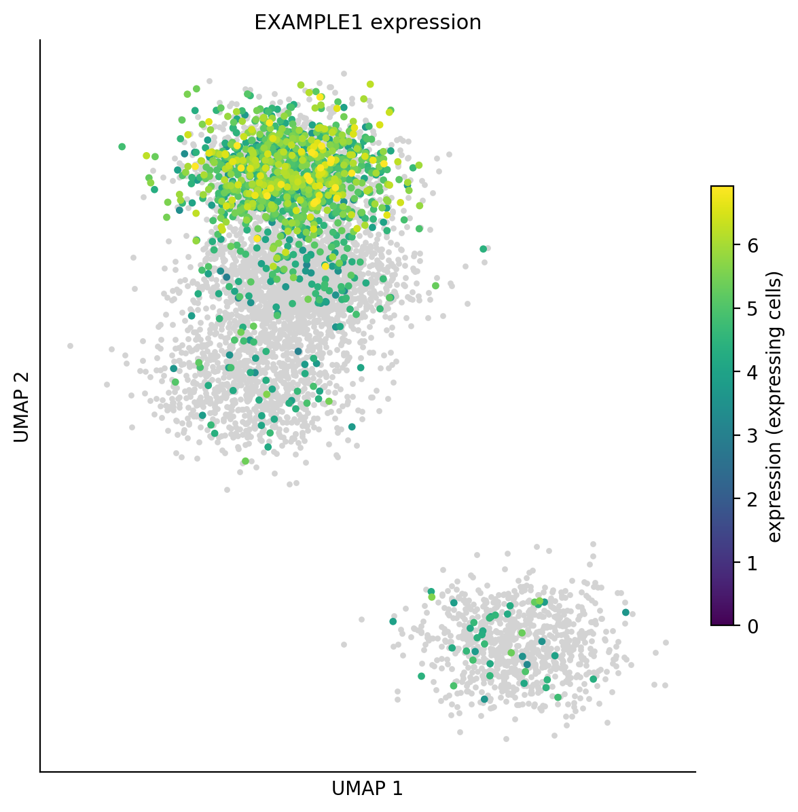
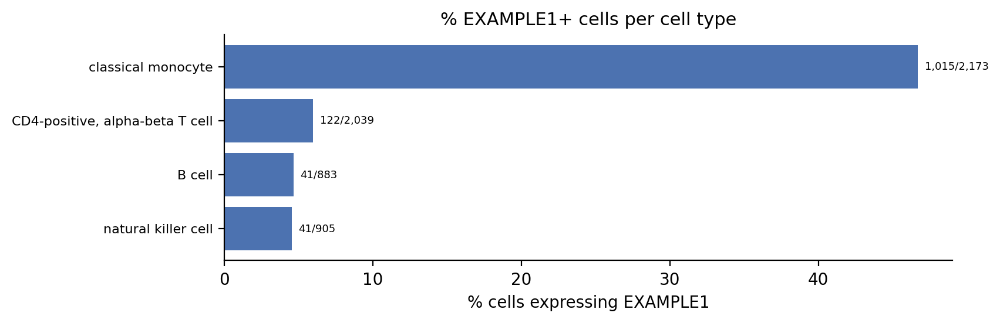
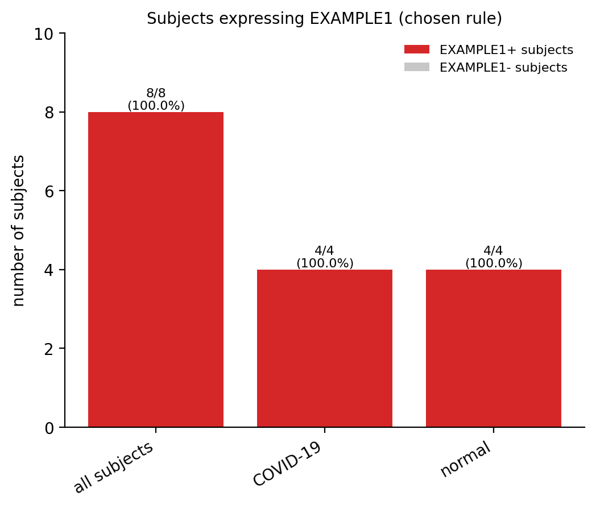
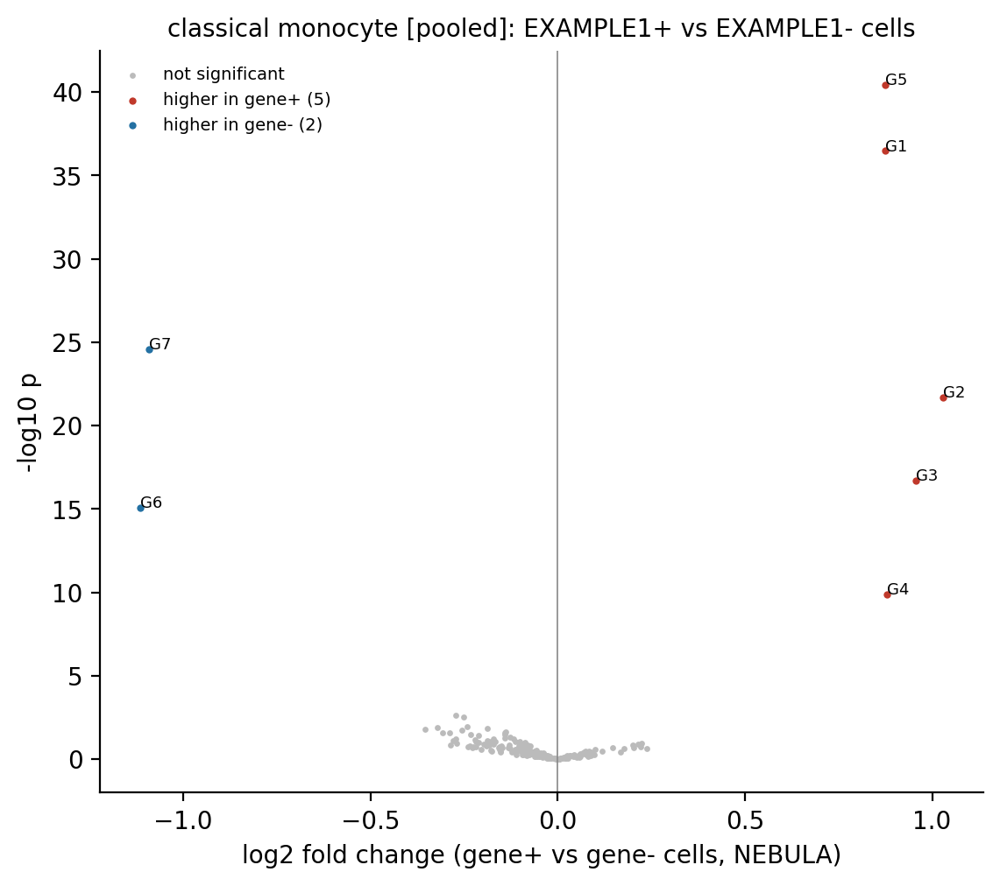

# cellxgeneExplorer

Analyse the expression of one gene in public single-cell datasets from [CELLxGENE Discover](https://cellxgene.cziscience.com), at the level of cells, cell types and patients, and summarise it across many studies.

You give it a paper title. It finds the study on CELLxGENE, downloads the data, asks for your gene, and reports:

- **Cellular level:** how many cells express the gene, in which cell types, with UMAPs and plots.
- **Cell-specific level:** the same for the cell populations you choose, broken down by disease, tissue and sex.
- **Patient level:** how many patients express the gene (number and proportion), overall and per group.
- **Differential expression (optional):** genes co-expressed with your gene within each cell type (NEBULA mixed model), and cell-proportion tests (Fisher's exact test).
- **Cross-study summary:** the gene across all the studies you analysed, plus reports for the cell types you choose.

Everything runs in **Jupyter notebooks** or in a **browser app**, with interactive plots (hover, zoom). Every table has a "How it's calculated" page with worked examples from your own data.

<p>


</p>
<p>


</p>

*Example output from the included synthetic dataset.*

## Installation

Python 3.9 or newer.

```bash
git clone https://github.com/teraweavetech/cellxgeneExplorer.git
cd cellxgeneExplorer
pip install -e .
```

Or with conda: `conda env create -f environment.yml && conda activate cxg-explorer`.

**Optional components**

| For | You need | Setup |
|---|---|---|
| NEBULA differential expression | R 4.4 or newer | `cxg-explorer setup-r` (installs the nebula package), or the **Install nebula** button in the app |
| Descriptive report | [Ollama](https://ollama.com) | `ollama pull gpt-oss:20b` (about 13 GB; needs roughly 16 GB RAM) |

Everything else works without them.

## Quick start

**Browser app**

```bash
cxg-explorer app
```

**Jupyter**

Open `notebooks/01_gene_explorer.ipynb` and run the cell:

```python
from cxg_explorer import explorer
explorer(out_dir="cellxgene_results", data_dir="cellxgene_data")
```

After analysing several studies, open `notebooks/02_cross_study_summary.ipynb`:

```python
from cxg_explorer import summary_panel
summary_panel(results_folder="cellxgene_results")
```

**Try it offline first**

```bash
cxg-explorer example
```

This writes `example_data/example_pbmc.h5ad`, a small synthetic dataset. Open it with "Open a local H5AD file" and analyse the gene `EXAMPLE1`.

## How it works

1. **Find the study.** Paste the paper title as listed on CELLxGENE, a DOI, or a collection link. Only CELLxGENE is searched.
2. **Choose groups.** All groups (for example normal, mild and severe disease) are analysed by default; keep one or two to focus a comparison.
3. **Analyse.** Type a gene and, optionally, the cell populations of interest.
4. **Review.** Check the results, the "How it's calculated" page and the Methods text.
5. **Optional steps.** Run differential expression, then generate a descriptive report. The report is generated only when you ask for it.

CELLxGENE's curated annotations (cell type, donor, disease, tissue, sex) and the authors' UMAP are used as deposited. Nothing is re-annotated or re-clustered. Expression is read directly from the file on disk, so large datasets don't need to fit in memory.

Results are organised as:

```
cellxgene_results/
  <study>/
    <GENE>__<dataset>/
      1_cellular_level/   2_cell_specific_level/   3_sample_level/   4_DE/
      interactive/        report.html   HOW_IT_IS_CALCULATED.html   METHODS.md
  _cross_study/<GENE>/   (cross-study summary and cell-type reports)
```

## Documentation

- [Installation and R/nebula setup](docs/installation.md)
- [Using the notebooks and the app](docs/usage.md)
- [Methods and statistics](docs/methods.md)
- [Output files](docs/outputs.md)
- [FAQ and troubleshooting](docs/faq.md)

## Citing

If you use this software, please cite it (see [CITATION.cff](CITATION.cff)) and cite the original studies and CELLxGENE Discover. The cross-study summary lists each study's reference.

## Licence

**PolyForm Noncommercial 1.0.0.** You may use, modify and share this software for **non-commercial purposes**: research, teaching, personal use, and use by non-profit, educational and government organisations. **Commercial use is not permitted** under this licence. See [LICENSE.md](LICENSE.md) for the full terms.

For a commercial licence, contact info@teraweavetechnologies.net.

Third-party components keep their own licences: nebula (R), anndata, plotly, Streamlit and others. Data downloaded from CELLxGENE is subject to the terms stated for each dataset.
